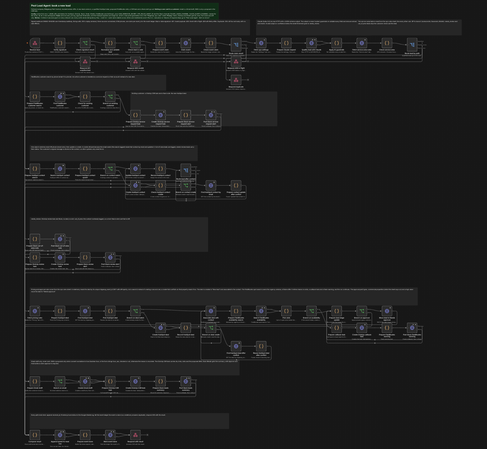
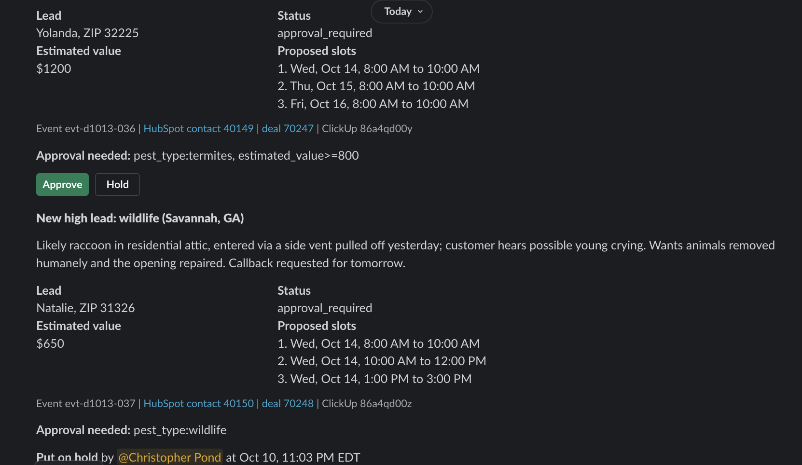
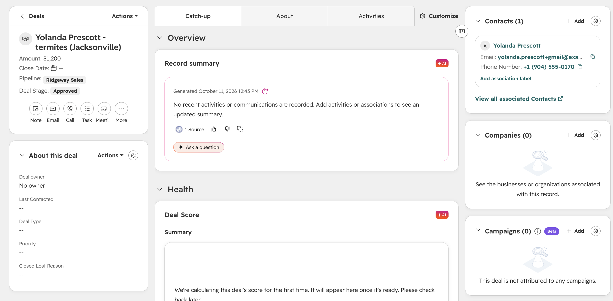

# n8n lead-to-booking agent

An n8n build for one part of a pest-control back office. A new lead comes in from a web form, call tracking or a HubSpot form. It leaves with a qualified HubSpot deal, up to three proposed FieldRoutes appointment slots, a ClickUp task for the customer service rep and a Slack message. Jobs that need a manager (most termite and wildlife jobs, commercial properties, anything estimated at $800 or more) wait in Slack for an **Approve** or **Hold** click, and that click updates the deal and the task.

Walkthrough video: https://www.tella.tv/video/ai-lead-to-booking-workflow-demo-0h51



| Slack: Approve / Hold, then the decision replaces the buttons | HubSpot: the same deal after the Approve click |
| --- | --- |
|  |  |

## What is real and what is not

- **Fictional company.** "Ridgeway Pest Control" and every customer are made up. Phones are 555-0100 to 555-0199, emails are on `.example` domains (`example.com` when sent to HubSpot), and prices are illustrative.
- **Real n8n.** n8n 2.42.6 runs the three workflows. The tests post HMAC-signed requests to the production webhook and check every vendor call and the resulting state.
- **Real Claude answers.** The qualification step is Claude Haiku 5.5, with a JSON schema and guardrails on its output. The tests replay recorded answers from real calls; a local bridge can make them live.
- **Two real vendors in the live modes.** Slack runs in a throwaway workspace (Socket Mode relay, so no public URL). HubSpot runs in a free developer test account, with the pipeline, stages and fields created by `pest-lead-agent/scripts/hubspot-setup.mjs`.
- **The rest is mocked.** FieldRoutes, ClickUp, Gmail, Google Sheets and the event ledger are a local mock server shaped like the real APIs, with injected failures (429, 503, timeouts after a write has gone through).

Nothing here has run in production or touched a real customer.

## What it checks

- **Duplicates.** Every write carries an idempotency key. An event ledger answers a redelivery that arrives during a run with a 409, and a failed run gives its claim back. In HubSpot, a unique `ridgeway_event_id` stops a second deal for the same lead. The full 40-lead day ran twice against HubSpot: the first run created 33 deals and reused 2, the second created 0 and reused 35.
- **Failures.** Network calls retry 3 times, 5 seconds apart (the three HubSpot lookups that may answer 404 are the exception, see the README). An error workflow posts to `#automation-alerts` and logs the failure without personal data. Non-critical failures, such as FieldRoutes being down, still finish the run with a callback task.
- **Privacy.** Slack, ClickUp and Sheets get ids, links, the first name and the ZIP only, and the tests check every message body for contact details.

## Run it

Needs Node 24 and n8n 2.42.6 (`pnpm add -g n8n@2.42.6 --allow-build=sqlite3`).

```sh
node --test pest-lead-agent/tests/              # unit tests, no network
node pest-lead-agent/tests/verify.mjs           # full replay run against a real n8n server (a few minutes)
node pest-lead-agent/scripts/simulate-day.mjs   # a simulated day of 40 leads, with a KPI report
```

The live Slack and HubSpot modes need your own tokens. See [`pest-lead-agent/README.md`](pest-lead-agent/README.md).

## Read more

- [`pest-lead-agent/README.md`](pest-lead-agent/README.md): architecture, demo data, live modes, limits.
- [`pest-lead-agent/VALIDATION.md`](pest-lead-agent/VALIDATION.md): every check and its result.
- [`pest-lead-agent/BUILD-LOG.md`](pest-lead-agent/BUILD-LOG.md): what broke during the build and how it was fixed.
- [`_shared/claude-bridge/`](_shared/claude-bridge/): the local bridge that answers Messages API requests with a signed-in Claude Code CLI, for testing only. A deployment points the same node at the Anthropic API with a key.

## License

MIT, see [LICENSE](LICENSE).
